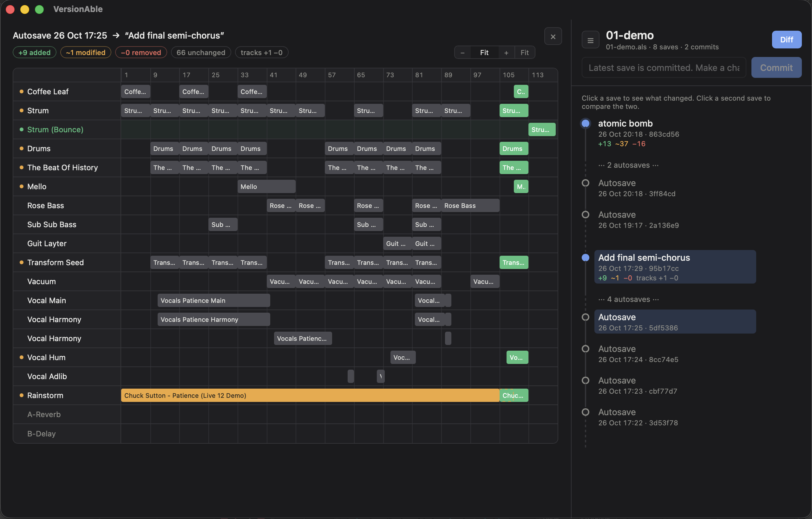

# VersionAble

**Never lose an idea in Ableton again.**

VersionAble sits beside Ableton and keeps every version of your project. Jump back to how the track sounded yesterday, or see exactly what you changed since then.

## What it does

- **Saves every version.**  Press ⌘S / Ctrl+S in Ableton as usual and it will be tracked in versionable.
- **Lets you bookmark versions.** Give a version a name like "drop finally works".
- **Shows what changed between versions.** Pick two versions and see your arrangement side by side. New clips are green, removed clips are red, and changed clips are orange.
- **Gets old versions back safely.** Restore any version as a new file next to your project. Your current set is never touched.

## Download

Get it from the [**Releases page**](../../releases/latest)

You may be warned that the app isn't from an identified developer:
- **Mac:** go to **System Settings -> Privacy & Security** and click **Open Anyway**.
- **Windows:** click **More info -> Run anyway**.

## How to use it

1. Click **+ Add project** and choose your Ableton set (`.als` file).
2. Make music and save as normal. Each save appears in the list.
3. Type a name and click **Commit** to name a certain version.
4. Click any version to see what changed. Click **Restore** to get it back.

*Branches will be introduced in the next version*

---

- Only the **arrangement view** is compared for now. Devices, automation and mixer comparisons will be introduced soon.
- Your history is stored in a `.vc` folder inside your project folder. If you move the project, move that folder with it, then add the set again.

---

Built with Rust and Tauri. `cd app && npm install && npx tauri dev` to run the app.
